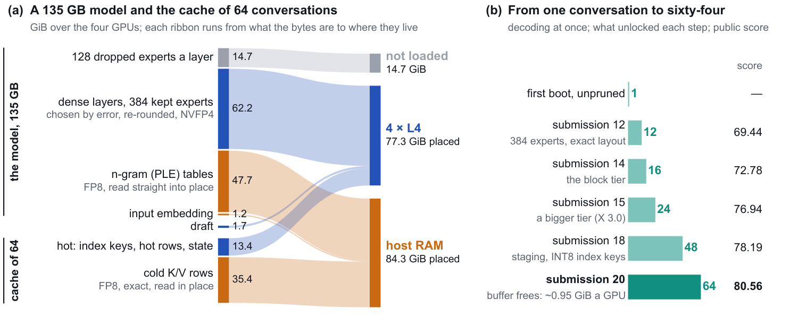
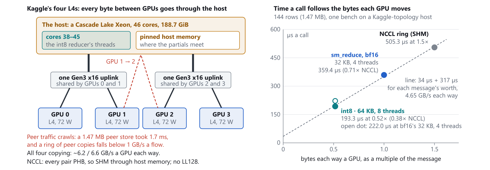
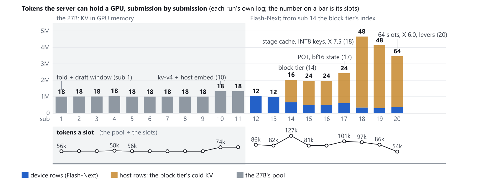
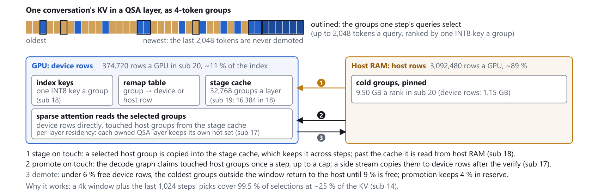
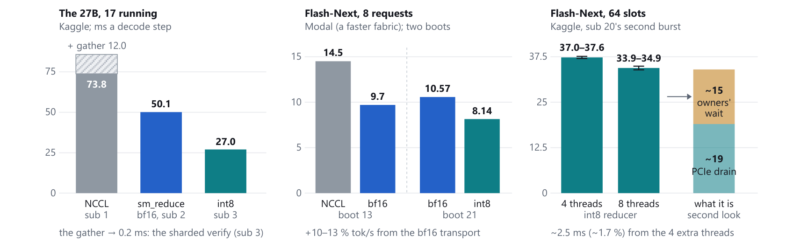
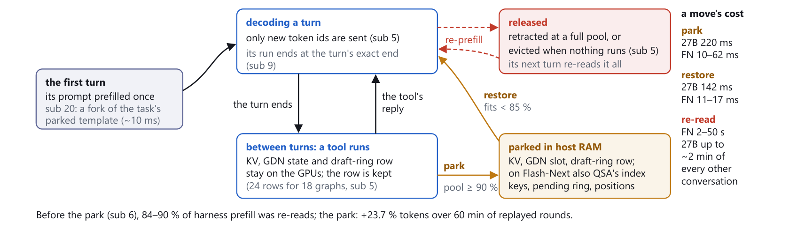
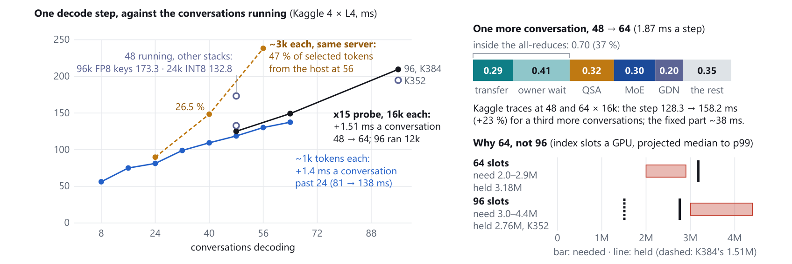

# SGLang optimizations for Qwen3.8-Flash-Next on 4 × L4

The two final submissions run Qwen3.8-Flash-Next on SGLang 0.5.21 with the patch in this folder. This document
explains what the patch changes and why: what each change measured, how exact it is, and which switch turns it on.
The diffs themselves, and how to apply them, are in [`README.md`](README.md).

One fact about Kaggle's 4 × L4 machine shaped every change: **attempts are bought with memory, not arithmetic.** The
agent checks every program it writes against the task's demonstrations, so more attempts give more verified
candidates. More attempts means more conversations decoding at once.
- **Concurrency is nearly free:** going from 8 to 64 conversations of about 1k tokens took the decode step from 56 to
  138 ms, eight times the conversations for 2.4 times the step.
- **The limit is how many conversations the cache can hold.** Making sparse-attention decode faster cut a
  12-conversation step by 17 %, but raised a full agent round's throughput by only 3 %, because the cache was full.

So most of the work went into memory: fitting a 135 GB model and a growing cache onto four 22.5 GiB GPUs, up from one
conversation at the first boot to 64 in the final submission.

*(a) Where the bytes of the 135 GB model and of the cache of its 64 conversations live, in GiB over the four GPUs.*
- *Each GPU holds its tensor-parallel share of the dense layers, 96 of each layer's 384 kept experts, the draft model,
  and the hot part of the cache: the index keys, the recently used K/V rows, the stage cache and the recurrent states.*
- *Pinned host RAM holds the per-layer n-gram embedding (PLE) tables, the input embedding, and 89 % of the
  sparse-attention cache's K/V rows.*
- *The 128 dropped experts of each layer are never loaded.*

*(b) The conversations decoding at once, from the first boot of the unpruned model to submission 20, with the change
that unlocked each step and the public score of the submission that first shipped it. "X 3.0" is the block tier's
multiplier (section 4.2).*

**Contents**
1. [The machine](#1-the-machine)
2. [The model, as served](#2-the-model-as-served)
3. [Fitting the weights](#3-fitting-the-weights)
4. [The KV cache: from 68,800 tokens to millions of slots](#4-the-kv-cache-from-68800-tokens-to-millions-of-slots)
5. [The decode step](#5-the-decode-step)
6. [Sessions: a conversation stays on the server](#6-sessions-a-conversation-stays-on-the-server)
7. [Prefill and admission](#7-prefill-and-admission)
8. [Concurrency: what one more conversation costs](#8-concurrency-what-one-more-conversation-costs)
9. [Start-up and the hazards that remain](#9-start-up-and-the-hazards-that-remain)
10. [How exact it is](#10-how-exact-it-is)
11. [The two finals' settings](#11-the-two-finals-settings)
12. [The switches](#12-the-switches)
13. [Tried and not adopted](#13-tried-and-not-adopted)

**How to read the numbers:**
- Each number is the one measured when a change was adopted, on Kaggle's 4 × L4 unless a platform is named.
- "27B" marks a measurement on Qwen3.8-27B, the model of submissions 1–11, where several of these parts were first
  built.
- Modal 4 × L4 hosts were used for screening only after a fabric check (NCCL within −4 % to +3 % of Kaggle). The
  4 × L40S and AVX2 hosts gave correctness checks and relative comparisons, never a Kaggle speed.
- Memory budgets are in GiB (2³⁰ bytes); checkpoint and file sizes are in GB (10⁹ bytes), as their sources report
  them. The 135 GB checkpoint is about 126 GiB.
- "Index slots" are places for one token in the KV index, and "state slots" hold one conversation's recurrent state.
  In the figures, "slots" means conversations decoding at once.

## 1. The machine

Two facts about Kaggle's `NvidiaL4` machine decided where nearly every change went.

**Bytes between GPUs move slowly, and only through the host.**
- **The topology:** the four L4s sit on PCIe Gen3 x16 behind a Cascade Lake Xeon, and each pair of GPUs shares one
  Gen3 uplink. `nvidia-smi topo` does not show this.
- **Rates:** with all four copying, each GPU gets about 6.2 / 6.6 GB/s each way. Peer traffic crawls: a 1.47 MB peer
  store takes 1.7 ms, and a ring of peer copies falls below 1 GB/s a flow.
- **NCCL:** it types every pair as PHB and stages each all-reduce through host memory (its SHM transport), and its
  ring moves 1.5× the message each way.
- **The consequence:** NCCL, a custom transport and bare copies all pace at about 4.7–5.1 GB/s a GPU each way. On
  this fabric a transport wins only by moving fewer bytes or by waiting less.

**The GPUs are power-capped, so the decode GEMMs are power-bound.**
- **The ceiling:** an L4 delivers about 259 GB/s of data. One GEMM reads at about 95 % of that.
- **Under load:** back-to-back decode GEMMs pin the 72 W cap and the SM clock falls (to 0.78–1.04 GHz on a bench
  chain; 1.33–1.89 GHz under serving load).
- **On Flash-Next:** the dense GEMMs stream 200–227 GB/s through cuBLAS, and the MoE runs at the bandwidth limit.
  - At 64 conversations its share of a step was 44.9 ms.
  - Reading all of a GPU's 12.7 GB of experts would take at least 49 ms, so a step reads most of the experts.
- **So kernel work paid in bytes and launches removed,** rarely in faster arithmetic.

**The host is part of the system.** It has 46 usable cores and 188.7 GiB of RAM:
- the CPU all-reduce runs on the last 8 cores (4 in submission 18);
- host RAM holds the n-gram tables, the cold part of the sparse-attention cache, and parked conversations.

*Left: the machine as measured. The shared uplinks do not show in `nvidia-smi topo`. NCCL's low-latency LL128
protocol is not used on this path, because its default enables it only over NVLink. Right: three all-reduce
transports at 144 rows (1.47 MB), measured in one bench on a Modal host with Kaggle's topology,
against the bytes each moves each way. `sm_reduce` and its int8 payload are the host-staged transport of section 5.1.
A call costs about 34 µs plus 317 µs for each message's worth of bytes, 4.65 GB/s each way: the fabric's own rate.
That is why every all-reduce change is a byte or a wait removed.*

## 2. The model, as served

**The layers.** Qwen3.8-Flash-Next has 48 layers:
- **36 Gated DeltaNet (GDN) layers,** with a fixed recurrent state per conversation;
- **12 Qwen Sparse Attention (QSA) layers,** whose cache grows with the conversation. Each query reads the 2,048 earlier
  tokens that an index over 4-token groups selects.

**The experts.** Each layer's mixture of experts has 512 routed experts, of which each token uses 10. The server
routes to 384 of them per layer (section 3).

**How it runs:**
- **Parallelism:** 4-way tensor and 4-way expert parallelism. Experts go whole to each GPU, because the expert
  shapes split four ways have no Marlin kernel config.
- **Experts:** NVFP4, run through Marlin W4A16, because the L4 has no FP4 tensor cores.
- **Everything else:** dense layers and the output head in BF16; the KV cache in FP8.
- **QSA decode:** a Triton kernel was written for it, because QSA had no path for the L4's architecture (sm_89).
- **Speculative decoding:** a small DFlash2 draft model proposes tokens, and the target model verifies a block of 4
  positions per request in each step: the last accepted token plus 3 drafted ones, so at most 4 tokens a step
  (section 5.3).

## 3. Fitting the weights

With the n-gram tables and the input embedding in host RAM (second row below), the full model's weights are about
19.4 GiB a GPU, on a card with about 21.7 GiB free.

| Change | What it does | What it measured |
|---|---|---|
| **Expert keep list** | The server routes only to 384 of each layer's 512 experts. The list is a JSON file given at start-up, and its order sets which GPU holds each expert. The 128 others are never loaded. How the lists were chosen is in [`../training/keep_c512/`](../training/keep_c512/) and [`../training/keep_census/`](../training/keep_census/) | weights 19.4 → 15.6 GiB a GPU |
| **The n-gram (PLE) tables and the input embedding in pinned host RAM** | The 51 GB of per-layer n-gram tables stay in the checkpoint's FP8 and are read by 8 threads straight into pinned host tables instead of through the page cache, where they had pushed out about 59 GB of the checkpoint (a fresh first boot still evicts about 49 GiB). The input embedding (BF16) is pinned in host RAM too | 12.2 GiB a GPU off the device; the loaded tables bit-equal on all four GPUs |
| **Load fixes** | Three copies the loader left behind are gone: the NVFP4 method's swizzled block-scale copies, which only FlashInfer's runners read (2.1 GiB a GPU); the Marlin repack's triple copy, now done in place and byte-identical; and 1.76 GiB of replaced block scales kept alive by a reference cycle. Logprob rows are computed in chunks of 128, so a prompt-logprob request no longer needs a 468 MiB allocation | even the newer stock SGLang v0.5.22 runs out of memory loading this model on an L4; these fixes make it load |

## 4. The KV cache: from 68,800 tokens to millions of slots

For most of the competition the binding resource was KV memory, not decode speed. A conversation grows to tens of
thousands of tokens, and the number that can decode at once is the cache divided by their length. The first boot that
served the model held 68,800 tokens for one request. Submission 20 held 3.47 million index slots a GPU for 64
conversations.

*KV capacity a GPU by submission, from each submitted run's own server log. Submissions 1–11 served the 27B, about 1M
tokens for 18 conversations. Flash-Next arrived with no more than that for 12. From submission 14 the bars are the
block tier's index: device rows (blue) and host rows (orange). The number on each bar is its conversations. Submission
20 spent its capacity on conversations rather than length: 64 at about 54k tokens each, against about 97k each at 48.
The labels name the change behind each step:*
- *"kv-v4" is the 27B's 4-bit V cache;*
- *"POT" is promote-on-touch;*
- *"X" is the block tier's multiplier (section 4.2);*
- *"levers" are the memory frees of section 4.3.*

### 4.1 The 3.6× pool: seven exact layout changes

A ledger of where each GPU's memory went found two structural facts:
- each QSA KV head was stored on two GPUs;
- the GDN snapshots (1.58 GiB) were bigger than half the pool.

Exact changes took the pool from 466,880 to 1,683,712 tokens a GPU (3.6×, measured with 320 experts):

| Change | Gain |
|---|---|
| **The QSA pair layer split:** of the two GPUs that share a KV head, one owns each QSA layer | 6,912 → 3,456 bytes a token |
| **The ReplaySSM fold in place of speculative state snapshots** (section 5.4) | +1.49 GiB a GPU |
| GDN recurrent state held for 18 conversations | +0.21 GiB |
| Vision blocks in pinned host RAM | +0.19 GiB |
| Two reserve cuts: a 96 MiB FlashInfer workspace, and no vision-language cache | +0.36 GiB together |
| Fewer captured graph sizes | +0.24 GiB (given back in the tuned configuration) |

### 4.2 The QSA block tier: most of the cache in host RAM

**The observation.** QSA's selections are local in time. In replayed agent conversations, a 4k-token recent window
plus every group selected in the last 1,024 steps covers 99.5 % of all selections, while holding about a quarter of a
125k-token request's KV.

**The mechanism.**
- **One address range:** one CUDA virtual-memory range can mix device pages and pinned host pages on an L4. The
  unmodified attention kernel reads through it.
- **Groups, not pages:** one map entry per 4-token group sends the group's four K/V rows to device memory or to host
  memory. A first version with 64-token pages freed almost nothing below about 100k context; 4-token groups kept
  1.4–1.7× less KV at equal miss rates.
- **The multiplier X:** the index holds X times the tokens the device pool alone would hold. Most of its rows live on
  the host. Submission 18 used 7.5 and submission 20 used 6.0.

**How it keeps the hot groups on the GPU** (the numbers match the figure below):
1. **Stage on touch.** A selected host group is copied into a per-layer stage cache, which keeps it across steps;
   past the cache it is read from host RAM.
2. **Promote on touch.** Inside the decode graph, each touched host group is claimed once a step, up to a cap. A side
   stream copies the claimed groups to device rows after the verify. Promotion keeps 4 % of the device rows in
   reserve.
3. **Demotion.** When free device rows fall below 6 %, the coldest groups outside the window return to the host until
   9 % is free. A request's newest 2,048 tokens are never demoted, but new groups start on the host when the device
   rows run out.

Two more pieces complete it:
- **Per-layer residency.** Each QSA layer a GPU owns keeps its own hot set, because together they need 1.43–1.57×
  the device rows.
- **The audit.** The tier's books are audited every round. The audit is a log-only check costing under 0.2 %.

**INT8 index keys.** QSA's index keys only rank which tokens each query attends; the attention then reads the same
K/V. Storing them in INT8 with a per-key scale freed more device rows. It is an approximation, measured at the noise
floor on 16 prompts at 16k.

*Every token's 4-token group has a place in the index. The newest window and the recently selected groups are kept on
the GPU. In submission 20 that is 374,656 usable device rows a GPU, about 11 % of the index, against 3,092,480 host
rows (9.50 GB of pinned host RAM a GPU); the figure's 374,720 includes one 64-row padding page. The tier moves the
same bytes and changes no arithmetic.*

| Step | What it measured |
|---|---|
| The block tier (submission 14) | index 980,032 → 2,030,400 slots a GPU at 16 conversations; by replay about 1.7× the capacity at 50k and 2.9× at 128k |
| Submission 17's stack: promote on touch, per-layer residency, the no-sync changes and the exact top-k (sections 5.2 and 7) | a 66k verify step 174.9 → 123.1 ms (−29.6 %), on an AVX2 host |
| Stage on touch, the stage cache, INT8 index keys (submission 18) | 4,657,408 index slots a GPU at 48 conversations, with the tier at 7.5× |
| The stage cache doubled to 32,768 groups (submission 19) | a step at 48 × 32k −3.0 %; the 96 steps after a prefill −13 % |
| 64 conversations at 6.0× (submission 20) | 3,467,136 index slots a GPU |

The nearest published relative is SGLang's HiSparse, which keeps a fixed hot buffer per request and swaps on a miss.
This tier instead shares device rows and one stage cache across requests, and can read a miss in place.

### 4.3 The last megabytes: six exact memory frees

A census recorded the owner of every live GPU block in submission 18's server. It found:
- 27 FlashInfer integer workspaces of 8 MiB each, holding plans of at most 2,878 B;
- an unused full-vocabulary logits buffer and its fallbacks, holding 359 MiB;
- an eager input registry sized for the tier's multiplied slots.

Six exact changes followed:

| Change | Freed |
|---|---|
| FlashInfer's integer workspaces at 1 MiB; one shared fp32 logits buffer at the vocabulary-shard width for every target-verify graph; the eager input registry capped at the prefill budget | 715 MiB a GPU (measured on 4 × L40S) |
| A lazily built graph mask; the expert-parallel map kept on the host; the draft's successor table compacted to its 32,768 rows | about 250 MiB a GPU at 96 requests |

Submission 20 spent them on going from 48 to 64 conversations.

## 5. The decode step

### 5.1 The all-reduce, through host memory

Tensor parallelism pays an all-reduce after every attention and MLP block. On the 27B, 140 all-reduces (73.8 ms) and
the logits all-gather (12.0 ms) were 47 % of a decode step at 17 conversations. Because the fabric's rate is fixed,
every gain came from moving fewer bytes or waiting less.

**A transport that moves each byte once (`sm_reduce`).** It is one kernel per call:
1. two sender thread blocks per GPU store the GPU's partial sum into pinned host memory in chunks, publishing each
   chunk with an epoch flag;
2. CPU threads add the four partials in rank order;
3. three receiver blocks load the sum back.

Each GPU moves the message once each way, against NCCL's 1.5×. It is not bit-identical to NCCL, which rounds at every
hop, but it is an exact reordering of the same sum.

**Eight bits on the wire.**
- **The format:** the same transport with an int8 payload both ways, one fp32 scale per 128 values. The CPU
  dequantizes, adds in rank order and requantizes.
- **Bytes:** 0.52× those of the bf16 transport. In one bench on a Modal host with Kaggle's topology, a call at 144
  rows took 193.3 µs against NCCL's 505.3.
- **27B:** the all-reduce share of a step fell 50.1 → 27.0 ms, +25.7 % steps a second.
- **Accuracy:** the output drift stayed within 1.12–1.14× that of an exact reordering. On hard outputs, on an earlier
  build, the exact all-reduce and the int8 one tied: 44 of 108 each, over four repeats of 27 hard outputs on
  4 × L40S.

**Out of the scheduler's way.** The last 8 cores (4 in submission 18) belong to the reducer threads, and everything
else is pinned elsewhere. One busy Python loop on a reducer core doubled a call.

**The host CPU's instruction set.** The reducer is compiled for the CPU it runs on: AVX-512, AVX2 with FMA, or a
generic build. The build is named after its instruction set, so caches never mix them. At start-up the server warns if
an AVX-512 host loads a build without it. If the reducer fails to start on any GPU, every GPU keeps NCCL.

**On Flash-Next:**
- **Decode, on a Modal 4 × L4 host at 8 requests:** the bf16 transport took the all-reduce from 14.5 to 9.7 ms a step
  (+10–13 % tokens a second). In a separate pair of runs the int8 path took it from 10.57 to 8.14 ms.
- **Prefill:** prefill all-reduces go through the reducer in pieces as well, so no NCCL call is left. A 48 × 16k fill
  took 15.9 % less time on Kaggle (372.2 → 312.9 s), within the drift gate (1.11–1.12× the noise floor).
- **Submission 20:** a 4,032 KB envelope sends a 10 MiB prefill reduction in three pieces instead of five, and 8
  reducer threads instead of 4 took the all-reduce at 64 conversations from 37.0–37.6 to 33.9–34.9 ms a step.

*The all-reduce's cost per decode step, in three settings with their own scales. On the 27B (Kaggle, 17
conversations), the host-staged transport and then its int8 payload took it from 73.8 to 27.0 ms; the sharded verify
(section 5.3) removed the 12.0 ms logits all-gather beside it. On Flash-Next at 8 requests, the bf16 transport cut it
by a third (a Modal host with a faster fabric). At 64 conversations on Kaggle it is still about 34 ms of a 145 ms step.
A profiler breakdown shows what is left: about 19 ms of PCIe drain, and about 15 ms waiting for the GPU that owns each
QSA layer. In the figure, "boot 13" and "boot 21" are two separate server starts, "sub 20's second burst" is the
second round of tuning runs for submission 20, and "second look" is that profiler breakdown.*

### 5.2 Sparse-attention decode

| Change | What it does | What it measured | Exactness |
|---|---|---|---|
| **The indexer's launch shape** | 16 groups × 1 pipeline stage, instead of one group × 3 stages for a loop that runs once | 5.5× faster a layer (415.5 → 75.6 µs at 262,144 context and 48 rows) | bitwise equal |
| **Direct sparse reads** | Attention reads the selected tokens straight from the FP8 cache, instead of gathering them into a bf16 scratch | 1,027 → 120 µs a layer with 2,051 tokens selected; with the indexer, a 12-conversation step −17 % | within one bf16 ULP |
| **The exact top-k** | Upstream's fast top-k clips an overflow bucket of more than 4,096 candidates and can drop true winners. The repair refines the bucket | wrong rows 0.04–0.06 % → 0 of 103,008 on real serving scores | the strict winners restored |
| **The grouped INT8 indexer** | Reads each request's index keys once for its 4 verify rows, instead of once a row | on one Colab L4: a call at 48 requests 951.6 → 514.5 µs (1.85×), about 5.71 → 3.09 ms of a GPU's step | logits bitwise equal in 12 of 12 kernel cases at up to 48 requests |
| **No −inf fill** | Skips filling logits past each row's length, which the top-k never reads | about 165 µs a call, so about 1 ms a step a GPU at 48 | exact |

### 5.3 Speculative decoding

Decode on these GPUs is memory-bound and pays a fixed all-reduce every step, so tokens per step is the lever.

**DFlash2.** A small block-diffusion draft proposes tokens, and the target verifies them in one pass. It accepts each
draft token with probability min(1, p/q), and after a rejection draws the bonus token from the normalized max(0, p − q).
This is standard speculative sampling: the output follows the target's own distribution after temperature, top-k and
top-p.

**Why the verify block is 4 positions, not 8.** Every verify row multiplies the per-row work of the whole model. At
16 conversations, a block of 8 ran 511 against block 4's 559 tokens a second (−8.6 %). Its extra ~21 ms a step was
work that grows with the rows, including 7.6 ms of MoE and 6.0 ms of all-reduce.

| Change | What it does | What it measured |
|---|---|---|
| **The fine-tuned draft h1** | DFlash2 fine-tuned on the agent's own conversations ([`../training/draft_h1/`](../training/draft_h1/)) | 2.3 % more tokens a verify step at block 4, simulated over 24 recorded conversations. In submission 20's load test, the median acceptance was 2.89 tokens a step |
| **The draft's candidate head** | The draft scores only a 32,768-token subset of the vocabulary, balanced across GPUs ([`../training/draft_vocab/`](../training/draft_vocab/)). It changes only the draft's proposals, so the target distribution is kept | a draft step's head 1,653.8 → 240.1 µs on one L4 |
| **The sparse verify accept** | The accept reads only the candidate tokens' probabilities, not full-vocabulary buffers | the sampler's reserve 778 → 312 MB, given to the cache |
| **The draft window KV** | The draft attends only to its last 2,047 positions, so it gets a ring per request, not a full-length cache. On the 27B the ring was 2,056 slots; the finals' paged ring rounds the window plus the 4-position block up to 2,112 | 27B: +29.9 % target KV |
| **The sharded verify** | Each GPU takes the top 20 of its own vocabulary shard, and only those are merged, instead of gathering every logit | 27B: the all-gather 12.1 → 0.2 ms a step in its own test, with probabilities bit-identical |
| **The draft's graph-index cap** | The draft's CUDA-graph index buffers sized to the requests it serves | draft graphs 0.62 → 0.22 GB |

### 5.4 The recurrent state

Speculative decoding makes the GDN layers' recurrent state costly, because a rejected draft must not stay in the
state. Stock SGLang keeps 8 state snapshots per request: 4.22 GiB at 14 slots on the 27B.
- **The ReplaySSM fold** (upstream PR #42209, backported) replaces the snapshots. During the verify the layers write
  their raw inputs to a small ring, and on commit the accepted prefix is replayed into the state. On Flash-Next it
  gave the pool 1.49 GiB a GPU and made a step 3.3 ms faster. It is exact up to floating-point order.
- **The recurrent state in bf16** (from submission 17), instead of fp32: on an AVX2 host, the step was 3.0 % faster at
  40k and 7.0 % at 66k, with 16.9 % more device rows. It is an approximation, checked on a short probe: on a 12.3k
  prompt with 1,500 decoded tokens, each arm's decode against its own prefill read 0.0235 for bf16 and 0.0239 for
  fp32. It was never compared with fp32 over a long decode on the same tokens.

### 5.5 Smaller decode changes

These are exact:
- **The expert-parallel top-k sum over local slots** (19.4 → 6.1 µs a layer at 96 rows), which also skips the
  expert-parallel zero-fill.
- **An expert-parallel map gather:** the global-to-local expert id map applied in one kernel.
- **Three upstream picks:** a pinned M-RoPE upload, an empty-cache fix, and an alignment rounding fix.
- **Census-balanced expert placement:** the slowest GPU's MoE excess fell from 2.88 to about 2.4 ms.
- **Two CPU-chain fixes in DFlash:** GPU idle time fell from 7.79 to 5.79 ms a step.

## 6. Sessions: a conversation stays on the server

Each attempt is a multi-turn conversation, and a first attempt takes a median of 14 turns. Before sessions, the chat
transport re-sent the whole conversation every turn: one attempt prefilled 707,362 tokens to generate 26,308.

| Change | What it does | What it measured |
|---|---|---|
| **Streaming sessions** | The server keeps a conversation's KV and recurrent state between turns, and each turn sends only its new tokens | 27B: decode 765–927 tokens a second, against 126–318 on the chat transport |
| **Retract and evict** | At a full pool a retraction releases a whole session, which re-prefills later. With nothing running, one idle session is evicted per pass, chosen by sequence number so every GPU picks the same one | a full pool no longer wedges the server |
| **Park and restore** | A session waiting on a tool is copied to host RAM when the pool is 90 % full, and restored when its history fits under 85 %. The copy covers its KV, recurrent-state slot and draft-ring row, and on Flash-Next also QSA's index keys, pending ring and positions | 10–62 ms a park and 11–17 ms a restore, against 2–50 s of re-prefill. 27B: exact, token for token on 10 of 10 prompts; +23.7 % tokens over 60 minutes of replayed rounds |
| **Exact turn boundaries** | A verify step commits a run of up to several tokens, and the stop token and budget are checked only afterwards, so the run past a turn's end was folded into the recurrent state. A length cap, a stop cap and a folded claim end every run exactly at the turn's end | 27B: on 2 of 3 prompts at 8.4k context, all 32 greedy tokens after the boundary agreed with the fix, against 0 of 32 without it. A spent attempt continues with 13–29k fresh tokens instead of re-reading 197k |
| **Session fork** (submission 20) | The first turn's prompt, up to the tool-specific tail, is prefilled once in a template session and parked, keyed by the task and its test input. Every attempt on that pair opens a fork of it; without a template it takes the ordinary session path. Only the prompt is shared, never an answer. There are at most 48 templates, least recently used dropped | first-turn prompts were 64 % of prefill tokens. On Kaggle: 53 templates, 56 forks, 0 refused, restores about 10 ms |

*A conversation's life on the server. It stays on the GPUs between turns, and each turn sends only its new tokens. When
the pool reaches 90 %, a session waiting on a tool is parked in host RAM, at a cost of milliseconds against the
seconds of re-reading its history. Every turn ends exactly where the scheduler ends it. From submission 20 each attempt
starts as a fork of its task's parked first-turn prompt. "FN" marks Flash-Next measurements; "27B" the earlier model.
"24 rows for 18 graphs" means the 27B server had 24 request rows for 18 decoding conversations, so a session waiting
on a tool kept its row.*

## 7. Prefill and admission

| Change | What it does | What it measured |
|---|---|---|
| **No host syncs** | Two host synchronizations dropped from QSA's metadata and from the extend. An extend's cost was the slowest GPU's CPU launch pace | the fill −8 %; small extends −20 % |
| **2,048-token prefill chunks** (submission 20) | At 1,024 tokens a pass needed about 337 ms of CPU for 256 ms of GPU work. At 2,048 it is GPU-bound | a prefill token 0.349 → 0.275 ms (−21 %) |
| **SGLang's prefill delayer** | Fills a prefill pass with up to 4 requests. Its per-GPU deadline is set to an hour, after a likely clock race between GPUs crashed a run at minute 45 | twice the multi-request passes |
| **A cap on a batch's summed context** (262,144 tokens) | QSA's cached-prefix extend copies each request's whole history; the cap keeps four long continuations from needing a gigabyte of transient copies | a memory guard; the first request always passes |

## 8. Concurrency: what one more conversation costs

Flash-Next climbed a ladder, each rung paid for in memory: 1, 12, 16, 24, 48, and 64 conversations.
- **The marginal cost:** at short contexts, each conversation past 24 added about 1.4 ms to a step (81 → 138 ms from
  24 to 64). On Kaggle with fresh 16k requests (the "x15 probe": submission 19's server with submission 20's
  switches), the step went from 125.1 ms at 48 to 149.3 at 64, 1.51 ms per added conversation.
- **Where that cost goes:** two profiled Kaggle runs at 48 and 64 × 16k, with a 352-expert list, measured 1.87 ms per
  added conversation. They put 37 % of it inside the all-reduces, most of that waiting behind the GPU that owns each
  QSA layer.
- **Why 64, not 96:** compute never set the count; the index did. At the contexts of a 48-minute run, 64
  conversations need 2.0–2.9M index slots (median to p99), which the 3.18M of the 64-slot test build held (submission
  20's final build holds 3.47M). 96 would need 3.0–4.4M. 80 conversations at 16k ran 182.2 ms a step
  against 145.0 at 64, with the pool 21.8 % smaller and twice the host share.

*Left: the decode step against the conversations running, on Kaggle. With about 1k tokens each and every row on the
GPU, each conversation past 24 added about 1.4 ms, so throughput kept rising to 64. With about 3k each the device rows
ran short: up to 47 % of selected tokens came from host RAM. The "x15 probe" curve is the 16k test of the text. Right:
what one more conversation costs from 48 to 64, and the index slots 64 and 96 conversations need against what each
test build held. "K384" and "K352" are 384 and 352 kept experts a layer.*

## 9. Start-up and the hazards that remain

**Seeds of compile caches.** Every compile cache is keyed differently: SGLang's JIT, Triton, inductor and the CPU
reducer's extension. So each submission ships a seed: a notebook whose output is every cache, built on Kaggle in the
submission's own image.
- **The check:** before booting from the seed, a check requires its hard fields to match: the GPU, both compilers,
  Python, every installed distribution, every patched file, and the switches and server arguments the caches depend
  on. Loader-only arguments and CPU affinity are left out.
- **The gain:** the server was up 9.15 minutes after kernel start, against 27.65 without a seed. In the archived
  benchmark runs it was ready 526 s after the first cell for submission 20, and 511 s for submission 18.
- **Why it matters beyond speed:** a long compile on one GPU, while the others spin in the CPU all-reduce, trips the
  all-reduce's poll limit.

**Boot checks.** These fail closed in a test run, and are logged in a scored one:
- **The expert count.**
- **The draft's CUDA graph:** it needs at least 1.0 GB free when its capture begins. Below that, DFlash runs the
  draft eagerly, about 11–20 ms a step slower, with one log line.
- **A KV pool above 600,000 tokens,** and the block tier on.

**Hazards carried to the end:**
- **The Marlin MoE kernel:** upstream issue #47188 reports that it can corrupt a few output rows on sm_89 when more
  than one block runs on an SM. The fix is not in the build: it was to be taken after a determinism test at these
  shapes, which was never run.
- **Free memory after ready** kept falling as kernels loaded late, to 0.30–0.35 GiB at the end of the load test, under
  SGLang's 1 GiB warning; none failed.
- **Chunked prefill** could continue past free pages (upstream #47593). The port sits behind a switch, off, because
  it needs an in-flight guard first.

## 10. How exact it is

The arithmetic was kept exact, or held to its noise floor: the difference the same measurement shows between two runs
that should agree.
- **What is never traded for capacity:** the experts stay at 4 bits and the cache at FP8, no conversation loses its
  earlier context, and the target model is not fine-tuned.
- **The approximations that remain:**
  - the vendor's 4-bit export;
  - the expert pruning and re-rounding;
  - the int8 all-reduce;
  - the INT8 index keys;
  - the bf16 recurrent state;
  - the FP8 KV cache and n-gram tables;
  - the 2,048-token prefill chunks and vision groups;
  - streaming sessions, which are close to, but not bit-exact with, re-sent conversations.

  Each one that was measured was compared with a noise floor measured beside it, and some were not measured: the
  2,048-token prefill chunks bring new GEMM shapes and kernels with no whole-path equality test.
- **Why no compute change could be certified bit-exact end to end on Flash-Next:** greedy decoding did not repeat on
  this stack in any of three configurations tested, and the same request scored twice differs by a mean |Δlogprob| of
  0.24–0.33. So "exact" there rests on construction, audits and kernel tests at named shapes.
- **On the 27B,** greedy decoding repeated exactly, and several changes were certified bit-identical end to end.

## 11. The two finals' settings

Both finals share the QG experts, the INT8 index keys, the draft h1 at block 4 with its 32,768-token candidate head,
the FP8 KV cache, the bf16 recurrent state, 4-way tensor and expert parallelism, temperature 1.0, 163,840 tokens an
attempt and up to four attempts per task. They differ in:

| | Submission 18 (57785004) | Submission 20 (57853136) |
|---|---|---|
| Server build | fork commit `5d76d788f1` | fork commit `c414512aa7`, plus three overlays: the request split (applied, switched off), the session fork, three later memory frees |
| Expert list | the routing-census list | re-chosen by layer error |
| Conversations at once | 48 (52 recurrent-state slots, 10 decode graph sizes) | 64 (68 slots, 12 graph sizes) |
| Block tier | multiplier 7.5, stage cache 16,384 groups, memory fraction 0.89 | multiplier 6.0, 32,768 groups, 0.899 |
| Prefill | chunks of 1,024 tokens; reductions above the CPU all-reduce's limit go to NCCL | chunks of 2,048, through the CPU all-reduce in pieces, with the prefill delayer and the summed-context cap |
| CPU all-reduce | 4 threads, messages up to 2,048 KB | 8 threads, up to 4,032 KB |
| Exact memory frees | none of the six | all six |
| Grouped INT8 decode indexer | off | on |
| Session fork | off | on |
| Vision encoding, tokens per chunk | 4,096 | 2,048 |

## 12. The switches

The launch command is in each final notebook's `launch_server.sh` cell (`6c30d806`), which also writes the resolved
arguments to `server_args.txt`. The environment switches are in its settings cell (`41aad7bc`), which prints them all
and comments each one. The table groups them by purpose, with submission 20's values; a switch with no value is set
to `1`. Four of the environment variables are upstream SGLang's own: `SGLANG_FLASHINFER_WORKSPACE_SIZE`,
`SGLANG_VLM_CACHE_SIZE_MB`, `SGLANG_LOGPROB_CHUNK_SIZE` and `SGLANG_TRITON_SLOW_COMPILE_THRESHOLD_SECS`. Every other
`SGLANG_*` variable is added by the patch.

| Group | Switches | What they do |
|---|---|---|
| Model and parallelism | `--tp 4 --ep-size 4 --quantization modelopt_fp4 --fp4-gemm-backend marlin --moe-runner-backend marlin` | NVFP4 experts through Marlin; 4-way tensor × 4-way expert parallelism |
| Memory and context | `--mem-fraction-static 0.899 --context-length 262144 --kv-cache-dtype fp8_e4m3 --page-size 64 --disable-radix-cache --max-running-requests 66 --max-mamba-cache-size 68 --mamba-ssm-dtype bfloat16 --min-free-slots-delay 1` | The bf16 recurrent state must be set by `--mamba-ssm-dtype`: with `--enable-linear-replayssm-spec` the server overwrites the environment variable with it |
| Graphs | `--cuda-graph-max-bs-decode 64 --cuda-graph-bs-decode 1 2 4 8 12 16 24 32 40 48 56 64 --disable-prefill-cuda-graph` | The 12 decode graph sizes |
| Prefill | `--chunked-prefill-size 2048 --enable-prefill-delayer --prefill-max-requests 4 --prefill-delayer-queue-min-ratio 0.07 --prefill-delayer-max-delay-passes 30 --prefill-delayer-max-delay-ms 3600000`; `SGLANG_PREFILL_MAX_SUM_SEQ_LEN=262144` | Section 7 |
| Speculative decoding | `--speculative-algorithm DFLASH --speculative-num-draft-tokens 4 --speculative-draft-model-quantization unquant --enable-linear-replayssm-spec --linear-attn-verify-backend triton`; `SGLANG_DFLASH_DRAFT_WINDOW_KV`, `SGLANG_AGI2_DRAFT_WINDOW_KV_PAGED`, `SGLANG_AGI2_DRAFT_VOCAB=<list>`, `SGLANG_ENABLE_DFLASH_SHARDED_VERIFY`, `SGLANG_AGI2_VERIFY_TAIL`, `SGLANG_AGI2_SPARSE_ACCEPT`, `SGLANG_AGI2_SPARSE_ACCEPT_CHUNK=8`, `SGLANG_AGI2_EARLY_PUBLISH`, `SGLANG_AGI2_DFLASH_PINNED_NTNP`, `SGLANG_AGI2_SWA_ONLY_WRAPPER0`, `SGLANG_AGI2_SWA_GRAPH_IDX_CAP`; `SGLANG_LOGPROB_CHUNK_SIZE=128` | Section 5.3. `--speculative-num-draft-tokens` is DFlash's block size, and the draft runs unquantized. `VERIFY_TAIL` takes the top-k before dividing by the temperature. `EARLY_PUBLISH` publishes a step's final lengths before the recurrent state is committed, so the CPU prepares the next step while the GPU works. `DFLASH_PINNED_NTNP` stages a token count through pinned host memory. `SWA_ONLY_WRAPPER0` and `SWA_GRAPH_IDX_CAP` give the draft, whose attention is all sliding-window, only the window's attention wrapper and an index buffer sized to the window |
| Sessions | `--enable-streaming-session`; `SGLANG_ENABLE_STREAMING_SESSION_RETRACT`, `SGLANG_ENABLE_STREAMING_SESSION_EVICT`, `SGLANG_ENABLE_STREAMING_SESSION_PARK`, `SGLANG_STREAMING_SESSION_PARK_HOST_GB=8`, `SGLANG_AGI2_QSA_SESSION_PREFIX`, `SGLANG_AGI2_QSA_RING2`, `SGLANG_AGI2_SESSION_FORK` | Section 6 |
| Exact turns | `SGLANG_ENABLE_DFLASH_LENGTH_CAP`, `SGLANG_ENABLE_DFLASH_STOP_CAP`, `SGLANG_ENABLE_STREAMING_SESSION_FOLDED_CLAIM` | Section 6 |
| Memory layout | `SGLANG_ENABLE_GDN_REPLAYSSM_FOLD`, `SGLANG_AGI2_QSA_PAIR_LAYER_SPLIT`, `SGLANG_AGI2_FN_VISION_HOST_BLOCKS`, `SGLANG_FLASHINFER_WORKSPACE_SIZE=100663296` (96 MiB), `SGLANG_VLM_CACHE_SIZE_MB=0`; `PYTORCH_CUDA_ALLOC_CONF=expandable_segments:True,pinned_max_round_threshold_mb:1024` | Section 4.1; the PyTorch setting gives exact pinned host buffers above 1 GB |
| Experts and weights | `--ple-offload-embedding --weight-loader-prefetch-checkpoints --model-loader-extra-config '{"num_threads": 2}'`; `SGLANG_AGI2_FN_EXPERT_KEEP=<list>`, `SGLANG_AGI2_FN_EXPERT_KEEP_ANY_ORDER`, `SGLANG_AGI2_HOST_EMBED`, `SGLANG_AGI2_PLE_DIRECT_READ`, `SGLANG_AGI2_PREFETCH_EXCLUDE=plefp8`, `SGLANG_AGI2_MARLIN_NO_SWIZZLED`, `SGLANG_AGI2_MARLIN_INPLACE_REPACK` | Section 3 |
| QSA decode | `SGLANG_AGI2_QSA_TRITON_DECODE`, `SGLANG_AGI2_QSA_IDX_GPC=16`, `SGLANG_AGI2_QSA_IDX_STAGES=1`, `SGLANG_AGI2_QSA_DIRECT_SPARSE`, `SGLANG_AGI2_QSA_INDEX_INT8`, `SGLANG_AGI2_QSA_IDX_SHARED_INT8`, `SGLANG_AGI2_QSA_NO_LOGITS_FILL`, `SGLANG_AGI2_FAST_TOPK_EXACT`, `SGLANG_AGI2_QSA_NOSYNC`, `SGLANG_AGI2_EXTEND_NOSYNC` | Sections 4.2, 5.2 and 7 |
| Block tier | `SGLANG_AGI2_QSA_BLOCK_TIER_X=6.0`, `SGLANG_AGI2_QSA_BLOCK_TIER_MAX_GROUPS=32768`, `SGLANG_AGI2_QSA_BLOCK_TIER_RESERVE=0.04`, `SGLANG_AGI2_QSA_BLOCK_TIER_LOW_WATER=0.06`, `SGLANG_AGI2_QSA_BLOCK_TIER_HYSTERESIS=0.03`, `SGLANG_AGI2_QSA_BLOCK_TIER_POT`, `SGLANG_AGI2_QSA_BLOCK_TIER_POT_AUDIT`, `SGLANG_AGI2_QSA_BLOCK_TIER_PERLAYER`, `SGLANG_AGI2_QSA_BLOCK_TIER_STAGE`, `SGLANG_AGI2_QSA_BLOCK_TIER_STAGE_MAX=32768`, `SGLANG_AGI2_QSA_BLOCK_TIER_STAGE_CACHE`, `SGLANG_AGI2_QSA_BLOCK_TIER_WINDOW=2048`, `SGLANG_AGI2_QSA_BLOCK_TIER_EVERY=64` | Section 4.2. Under promote-on-touch the tier's rounds run every 32 decode batches (the default of `SGLANG_AGI2_QSA_BLOCK_TIER_POT_EVERY`), not every `EVERY` steps |
| CPU all-reduce | `SGLANG_ENABLE_SM_REDUCE_ALLREDUCE`, `SGLANG_SM_REDUCE_FMT=int8`, `SGLANG_SM_REDUCE_DOWNQ`, `SGLANG_SM_REDUCE_THREADS=8`, `SGLANG_SM_REDUCE_CHUNK_KB=64`, `SGLANG_SM_REDUCE_PUBWARP`, `SGLANG_SM_REDUCE_CPUS` (the last 8 CPUs the container may use), `SGLANG_SM_REDUCE_MAX_KB=4032`, `SGLANG_AGI2_SMR_SPLIT` | Section 5.1. `DOWNQ` sends the sum back in int8 too. With `PUBWARP` one sender warp only fences and publishes while the others store, so a chunk's fence overlaps the next chunk's stores |
| Memory frees | `SGLANG_AGI2_FI_INT_WORKSPACE_BYTES=1048576`, `SGLANG_AGI2_SHARD_LOGITS_BUFFER`, `SGLANG_AGI2_EAGER_CAP`, `SGLANG_AGI2_LAZY_GRAPH_MASK`, `SGLANG_AGI2_EPLB_MAP_HOST`, `SGLANG_AGI2_DRAFT_SUCC_COMPACT` | Section 4.3 |
| Smaller decode changes | `SGLANG_AGI2_MROPE_ASYNC`, `SGLANG_AGI2_MOE_EMPTY_CACHE13`, `SGLANG_AGI2_MOE_EP_SUM`, `SGLANG_AGI2_EP_MAP_TRITON` | Section 5.5 |
| Vision | `SGLANG_MM_ENCODE_MAX_TOKENS=2048` | The vision encoder in groups of at most 2,048 tokens |
| Diagnostics | `SGLANG_TRITON_SLOW_COMPILE_THRESHOLD_SECS=0` (upstream) | Logs every Triton compile after the server starts |
| Left unset | `SGLANG_AGI2_QSA_REQ_SPLIT` | The request split (section 13) is in the build but stays inert |

## 13. Tried and not adopted

| Tried | What it measured |
|---|---|
| NCCL's own settings, and forced peer-to-peer | no setting beat the default; forced peer-to-peer about 3× slower |
| FlashInfer's peer-to-peer all-reduce (27B) | a decode step 5.4× slower on Kaggle (774 against 143 ms) |
| The QSA request split: both GPUs of a pair run every QSA layer, each on half the requests | +0.5 % at 48 conversations, and 19 % of the pool on 4 × L40S; in the build, switched off |
| A block of 8 on Flash-Next | −8.6 % at 16 conversations (section 5.3) |
| Ragged verify: a per-step choice of verify rows per request | −2.4 % end to end on 4 × L40S |
| An FP8 output head | +3.9 % tokens a second; dropped after it scored 15 of 19 hard tasks against 16 of 19 |
| FP8 dense layers (W8A8) | −2 ms a step at 1.7× the drift floor |
| FP8 index keys; 4-bit K and V; KV latents | 1.27× the floor; 2.1–2.6× the floor; 7–107× FP8's attention error |
| SGLang's own host offload (radix cache with HiCache write-back, 27B) | −23 to −25 % against every other arm |
| Moving the GDN fold to a side stream, or fusing it | 1.3–2.1 ms a step slower; the fused kernel saved 3.45 ms but was not exact |
| 32 conversations, at the 24-conversation settings | out of memory at the block tier's first round; with promote-on-touch, 3–6 % slower than 24 |
| 80 conversations | 182.2 ms a step against 145.0 at 64 (16k each), with the pool 21.8 % smaller: no gain per conversation |
| 96 conversations | faster at fixed short loads, but the index fell short of what a long run's contexts need (section 8) |
| Dropping earlier turns' reasoning at 60k tokens (27B) | −7.0 % attempts an hour: each rebuild froze decoding for a median 12.7 s |
| 352 experts a layer instead of 384 | first answers right on 57 of 78 outputs, against 61 with 384 |
| More training data for the draft | +0.0126 accepted tokens a step, against a bar of +0.15 |

**Staying on SGLang 0.5.21.** No newer upstream release was found to speed this path. v0.5.22 cannot load this model
on an L4 unpatched, and porting to it would have silently disabled the session hooks. Instead, three small upstream
fixes were taken onto v0.5.21 (section 5.5).
